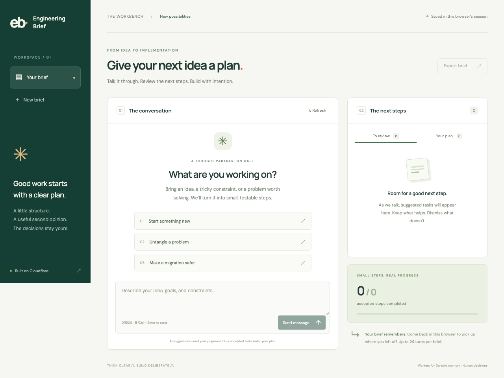
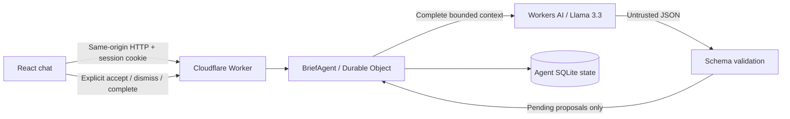

# Engineering Brief

## Prompt History

See [PROMPTS.md](PROMPTS.md) for the AI-assisted coding prompt history and
development summary. The application's runtime system prompt is versioned in
[src/model.ts](src/model.ts).

## Overview

Repository: [thestephenromano/cf-ai-engineering-brief](https://github.com/thestephenromano/cf-ai-engineering-brief) (public).

An AI planning partner built on Cloudflare. Describe an engineering problem,
discuss constraints, and review small tasks with observable acceptance criteria.
The assistant proposes; you decide what enters the plan.



## Assignment requirements

| Requirement                | Implementation                                                                                                      |
| -------------------------- | ------------------------------------------------------------------------------------------------------------------- |
| LLM                        | Llama 3.3 on Workers AI via the `AI` binding; schema-validated JSON responses                                       |
| Workflow / coordination    | `BriefAgent` from the Agents SDK coordinates inference and serializes mutations in a Durable Object                 |
| User input                 | Responsive React chat served through Workers Static Assets                                                          |
| Memory / state             | SQLite-backed Agent state persists conversation, task decisions, and request IDs across reloads and object eviction |
| AI-assisted prompt history | [PROMPTS.md](PROMPTS.md) records the task prompts and points to the runtime system prompt                           |
| CI/CD                      | GitHub Actions check, runtime/build, and browser jobs; a separate manual Cloudflare deployment workflow             |

## Run locally

Use Node **24.19.0** and npm. The Node version is recorded in `.node-version`
and the test/build toolchain is locked in `package-lock.json`.

```sh
npm ci
npm exec wrangler login
npm run dev
```

Open the local URL printed by Wrangler, normally `http://localhost:8787`.
The `AI` binding uses your authenticated Cloudflare account even during local
development. No OpenAI key or `.env` file is required. The account needs access
to Workers AI. Local Durable Object storage lives in `.wrangler/`.

For a **clearly synthetic, offline UI demo** without Cloudflare credentials:

```sh
npm run dev:fixture
```

Open `http://localhost:8788`. That command uses `tests/fixture-worker.ts`, which
always returns the same sample webhook tasks. It exercises the real Worker,
Agent and storage, but **does not call an LLM**. Production configuration does
not import it. Use `npm run dev` for real model responses.

## Try the complete flow

1. Choose “Untangle a problem” or describe your own goal and constraints.
2. Send the message. Suggested tasks appear under **To review**.
3. Accept one task and dismiss another. Open **Your plan**.
4. Mark an accepted task complete and refresh the page: the conversation and
   decisions remain.
5. Export a Markdown brief containing the conversation and accepted tasks.

The browser holds a random HttpOnly session capability; there is no shared
`default` conversation. Keep the same browser to resume a brief. A new brief
rotates the capability, and the UI asks you to export first if you want a copy.
Clearing cookies loses access to the old session. Sessions allow 24 turns with
bounded text and model context; the server refuses excess context rather than
silently dropping earlier instructions.

## Architecture



The model cannot choose task IDs or statuses. A successful turn commits the user
message, assistant reply, and pending proposals together. Invalid responses or
provider failures preserve the prior state. The Agent rejects overlapping
mutations; idempotency keys make a retry of a committed message safe. Reads
remain available during inference. An interrupted, uncommitted inference can
be billed again on retry; this is not an exactly-once inference guarantee.

See [the behavioral contract](docs/CONTRACT.md),
[architecture](docs/ARCHITECTURE.md), and [operations](docs/OPERATIONS.md).

## Verify

```sh
npm exec playwright install chromium
npm run verify
```

`verify` runs formatting, lint, strict type checking, local evidence validation,
gate-validator tests, behavioral/property tests in the Workers runtime, a
production build, desktop/mobile browser tests, and the dependency audit.
Run `npm run lint:ci` separately to validate GitHub Actions with a checksum-pinned
actionlint binary. Its initial download requires internet access.

Tests use controlled AI responses. They establish application behavior, not the
quality of model advice. Actual inference and hosted deployment require your
Cloudflare account. [RESULTS.md](RESULTS.md) distinguishes executed checks from
unverified deployment and forge configuration.

## GitHub CI/CD

`.github/workflows/ci.yml` runs on pull requests, pushes to `main`, manual runs,
and a weekly schedule. The schedule reruns the advisory scan even when no code
has changed. It retains the production build and browser screenshots/traces.
External actions are pinned to commit SHAs; Dependabot proposes updates.

To enable deployment:

1. Create a GitHub **production** Environment, restrict it to `main`, and add
   required reviewers if available for the repository's GitHub plan.
2. Add the environment secret `CLOUDFLARE_API_TOKEN` and environment variable
   `CLOUDFLARE_ACCOUNT_ID`. Use an account-scoped Cloudflare deployment token
   with Workers and Workers AI access. Do not commit credentials.
3. Protect `main`: require **Check**, **Runtime tests and build**, and
   **Browser assurance**, plus pull-request review.
4. In GitHub Actions, manually run **Deploy to Cloudflare** on `main`.
   It reruns the complete CI workflow for that revision, downloads its verified
   static assets, waits at the production Environment, then deploys with Wrangler.

The workflow declares the Environment; required reviewers and branch protection
must be configured in GitHub settings. They are not created by a YAML file.
`main` currently requires one approving review, up-to-date passing CI, and
resolved discussions; force pushes and branch deletion are blocked. The sole
owner retains the GitHub admin override. All outside contributors require
approval before their pull-request workflows run, and have no direct write access.
Check the repository settings and [Actions runs](https://github.com/thestephenromano/cf-ai-engineering-brief/actions) for the current protection and execution status.

Manual deployment after local verification is also available:

```sh
npm exec wrangler login
npm run verify
npm run deploy
```

Wrangler prints the deployed `workers.dev` URL. No URL is fabricated in this
repository. Before exposing a shared demo publicly, add Cloudflare Access or
an appropriate edge rate limit: session bounds do not prevent an anonymous
caller from creating many sessions.

## Engineering provenance and submission

Developed using the local `ai-program` engineering templates and reduced-scope
Assay workflow. This is an application exercise, not a formally verified system
or an A0–A3 certification. Project-specific parameterization and evidence records
are under `docs/validation/`. The repository, source code, and prompt history
are public at the owner’s explicit request. The full proprietary Assay program
is not included.

Original platform references consulted on 2026-10-27:

- [Cloudflare Agents overview](https://developers.cloudflare.com/agents/)
- [Agents quick start](https://developers.cloudflare.com/agents/getting-started/quick-start/)
- [HTTP Agent handlers](https://developers.cloudflare.com/agents/runtime/communication/http-sse/)
- [Llama 3.3 model](https://developers.cloudflare.com/workers-ai/models/llama-3.3-70b-instruct-fp8-fast/)
- [Workers AI JSON mode](https://developers.cloudflare.com/workers-ai/features/json-mode/)
- [Workers runtime testing](https://developers.cloudflare.com/workers/testing/vitest-integration/)

No third-party publication was copied into this project. The lockfile records
the exact SDK/tool versions used; documentation URLs themselves are mutable.
